<!-- layout: title-sidebar -->
<!-- valign: bottom -->

# From Classical RL to Frontier LLMs

<div class="colloquium-title-eyebrow">18 November 2026</div>

<div class="colloquium-title-meta">
<p class="colloquium-title-name">Nathan Lambert</p>
</div>
---

## Post-training (RL) now takes most of a frontier lab's compute

<!-- footnote-right: [SemiAnalysis, via OfficeChai](https://officechai.com/ai/while-share-of-inference-has-held-steady-over-the-last-2-years-pre-training-compute-has-moved-to-post-training-semi-analysis/) -->

<!-- img-align: center -->

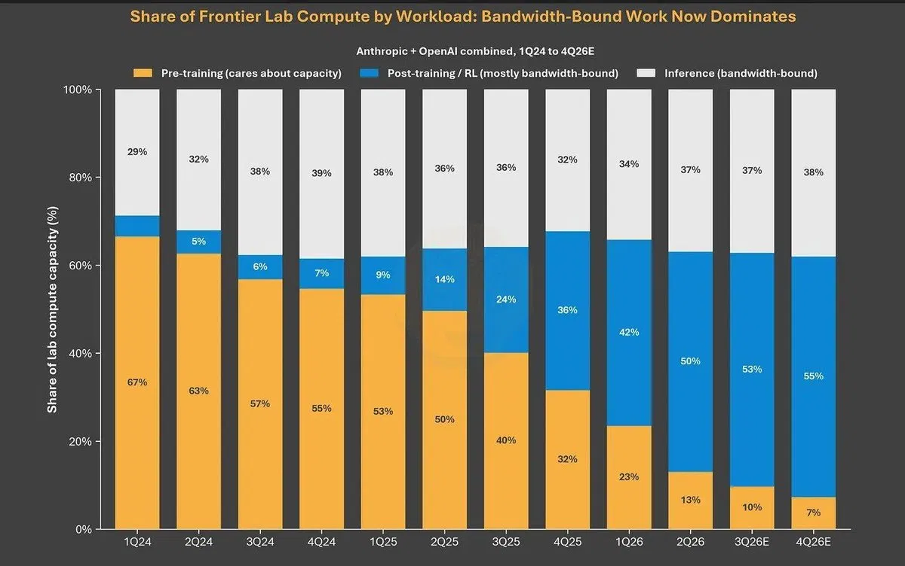

---

## How the times have changed!

RL compute relative to pretraining compute for the same model, in GPU-hours:

<div class="compute-table">

| Model | Pretraining | RL | RL / pretraining |
|---|---|---|---|
| **DeepSeek R1** <small>Jan 2025<br>671B total, 37B active</small> | **2.66M** <small>H800 GPU-hours [@deepseekai2025deepseekv3technicalreport]</small> | **0.14M** <small>H800 GPU-hours [@guo2025deepseeknature]</small> | **~5%** |
| [**Beam**](https://reflection.ai/blog/introducing-beam) <small>Oct 2026<br>501B total, 23B active</small> | **< 4.1M** <small>6,144 GB300s for under 4 weeks</small> | **~7.1M** <small>10.5K GB300s for 4 weeks</small> | **> 1.7×** |
| [**Inkling 2 Small**](https://thinkingmachines.ai/news/inkling-2-small) <small>Nov 2026<br>594B total, 17B active</small> | **~0.11M\*** <small>~1.5K GPUs for under 3 days</small> | **~0.44M** <small>2,048 GPUs for 9 days</small> | **~4×\*** |

</div>

<div class="compute-note">*Estimated: Thinking Machines report the pretraining duration but not the GPU count. GPU-hours ignore utilization. RL spends much of its time sampling, so its share of FLOPs is smaller than its share of GPU-hours.</div>

---

<!-- valign: center -->
## What this lecture covers

How RL is approached with LLMs and what the challenges of RL are for frontier models.

RL is mostly an engineering, stability, and throughput problem at the frontier. The learning signal is important, and mostly comes through data engineering (not the focus of this lecture).
---

## What this lecture covers

How RL is approached with LLMs and what the challenges of RL are for frontier models.

Some examples we include: 

1. **Policy gradients in LLM code.** How LLM log-probs, logits, and a surrogate loss turn REINFORCE into a few lines of PyTorch.
2. **Asynchronous RL systems.** How RL training is usually done for large LLMs.
3. **Training-inference mismatch.** A common challenge that many of the latest RL algorithms address.

---

## Notation in this lecture

<div class="notation-table">

| Symbol | Meaning | Book / lectures |
|--------|---------|-----------------|
| $x$ | Prompt | $s$ |
| $a = (a_1, \dots, a_T)$ | Completion, one token at a time | $a$ |
| $v \in \mathcal{V}$ | Any token in the vocabulary | $v$ |
| $p_\theta$ | **Learner**: the training framework's (e.g., FSDP) next-token distribution | $\pi_\theta^{\text{learner}}$ |
| $q$ | **Sampler**: the inference engine's (e.g., vLLM) next-token distribution (no gradient updates) | $\pi_\theta^{\text{sampler}}$ |
| $f_\theta$ | Logits, so $p_\theta = \text{softmax}(f_\theta)$ | |
| $\boldsymbol{\xi}_v = \nabla_\theta \log p_v$ | Gradient "**score**" of token $v$ | $\boldsymbol{\xi}_v$ |
| $A$ | Advantage for the whole completion, e.g., $r - b(x)$ | $A$ |

</div>

$p_v$ and $q_v$ are shorthand for the probability of token $v$ at one position, given $x$ and the prefix $a_{<t}$. CS 4789 uses the same $x$ and $a$.

---

<!-- layout: section-break -->

## Implementing RL basics with an LLM

---


<!-- columns: 50/50 -->
<!-- valign: center -->
## RL review: The agent–environment loop

**Classical RL**: agent in an MDP $(\mathcal{S}, \mathcal{A}, P, r, \gamma)$

- Reward is a known function from the environment per step
- Optimize cumulative return: $J(\pi) = \mathbb{E}_{\tau \sim p_\pi}\!\left[\sum_{t} \gamma^t r(s_t, a_t)\right]$

|||

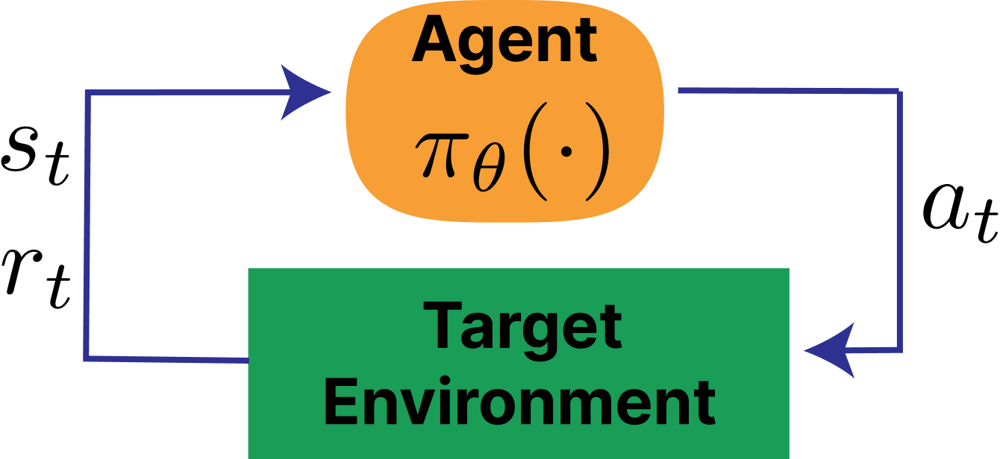

---

## Language models as episodic MDPs

| MDP concept | Language model |
|-------------|---------------|
| State $s_t$ | Prompt + tokens generated so far: $(x, a_{<t})$ |
| Action $a_t$ | Next token $a_t$ |
| Transition | Deterministic-ish: append token to sequence (tokens are sampled probabilistically) |
| Policy $\pi_\theta(a_t \mid s_t)$ | LM next-token distribution |
| Episode | One prompt → completion |
| Terminal reward | RM score, verifier output, judge-scores |
| $\gamma$ | Typically 1.0 (no discounting) |

<!-- step -->

Two implementation-level views of this MDP: **token-level** (each token is a separate action, used in PPO with GAE) vs. **sequence-level** (entire completion is one action, used in REINFORCE/GRPO).

---

## Agentic RL complicates the MDP

<div class="mdp-table">

| MDP concept | RLVR | Agentic RL |
|-------------|------|------------|
| State $s_t$ | Prompt + tokens so far | Context (prompt + tokens + tool outputs), plus hidden environment state (files, services, other users) |
| Action $a_t$ | Next token | Next token (many are tool calls) |
| Transition | Deterministic-ish: append token | More stochastic: the environment runs the call and appends its output |
| Episode | One prompt → completion | Many turns; [Inkling 2 Small](https://thinkingmachines.ai/news/inkling-2-small)'s p99 rollout takes 4 hours |
| Terminal reward | Verifier on the final answer | Tests on the final state of the environment |
| Loss | Every completion token | Tool-output tokens are masked: the model must not learn to predict the environment |

</div>

Math RL needed prompts and answer checkers. Agentic RL needs **environments**: containers, real file systems, services, verification tests [@ivison2026tmax]. **Building worlds for LLMs is hard.**

---


<!-- class: diagram-md -->
## RL for LLMs: RLVR

<!-- img-align: center -->

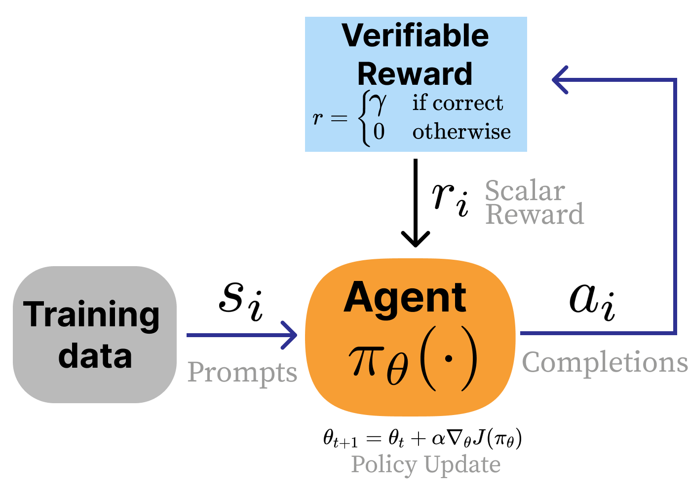

---

<!-- class: diagram-md -->
## RL for LLMs: Agentic RL

<!-- img-align: center -->

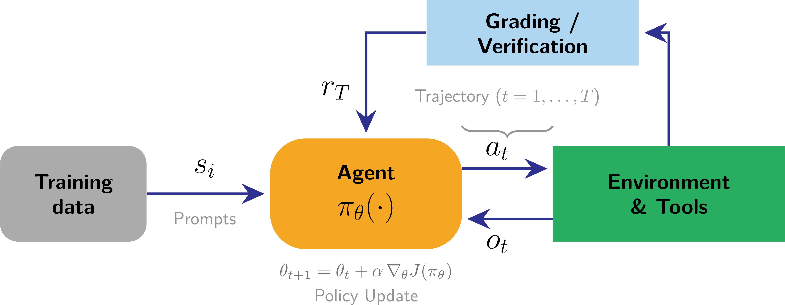

---

## Recall: The policy gradient

The objective and its gradient:

$$J(\theta) = \mathbb{E}_{\tau \sim p_\theta}[R(\tau)]$$

$$\nabla_\theta J(\theta) = \mathbb{E}_{\tau \sim p_\theta}\!\left[\sum_{t=0}^{T} \Psi_t \nabla_\theta \log \pi_\theta(a_t \mid s_t)\right]$$

The gradient says: for each sampled token, compute the direction in parameter space that makes it more likely ($\nabla \log \pi$), then scale by how much better than expected it was ($\Psi_t$).

---

## Recall: Why losses are sums of log-probs

The policy gradient derivation gives:

$$\nabla_\theta \log p_\theta(\tau) = \sum_{t=0}^{T} \nabla_\theta \log \pi_\theta(a_t \mid s_t)$$

So we write a loss whose negative gradient is the policy gradient, treating each advantage $A_i$ as a constant across the trajectory:

$$
\begin{aligned}
L(\theta) &= -\frac{1}{N} \sum_{i=1}^{N} A_i \sum_{t} \log \pi_\theta(a_{i,t} \mid s_{i,t}) \\
-\nabla_\theta L(\theta) &= \frac{1}{N} \sum_{i=1}^{N} A_i \sum_{t} \nabla_\theta \log \pi_\theta(a_{i,t} \mid s_{i,t})
\end{aligned}
$$

Gradient descent on $L$ is gradient ascent on $J$.

---

## From the loss to autodiff

In code, we compute the **log-probs** and let autodiff handle the gradient:

```python
seq_log_probs = (token_log_probs * completion_mask).sum(dim=-1)
loss = -(seq_log_probs * advantages.detach()).mean()
loss.backward()  # fills each parameter's .grad with ∇L
optimizer.step()  # θ ← θ - η ∇L
```

`loss.backward()` runs backpropagation: it computes $\partial L / \partial \theta$ for every parameter. 

`optimizer.step()` applies the update. 

The loss values themselves are often weird in RL (e.g. zero-centered distributions, rather than nice decreasing accuracy metrics of pretraining)

Most RL algorithms used today are variations on this computation.

---

## Computing log-probabilities (expanded)

The fundamental building block: per-token log-probabilities from the policy. 

```python
# Forward pass through the model
logits = model(input_ids).logits              # (B, L, vocab_size)

# Autoregressive shift: logit at position t predicts token at t+1
logits = logits[:, :-1, :]                    # (B, L-1, vocab_size)
labels = input_ids[:, 1:]                     # (B, L-1)
completion_mask = completion_mask[:, 1:]       # (B, L-1)

# Per-token log-probs
log_probs = logits.log_softmax(dim=-1)
token_log_probs = log_probs.gather(dim=-1, index=labels.unsqueeze(-1)).squeeze(-1) # (B, L-1)

# Per-sequence log-prob: sum over completion tokens
seq_log_probs = (token_log_probs * completion_mask).sum(dim=-1)
```

Everything in log-space to avoid numerical underflow from multiplying many small probabilities.

---

## The REINFORCE loss in code

The simplest policy gradient loss:

```python
# rewards: (B,) — one reward per sequence
# seq_log_probs: (B,) — sum of log-probs over completion tokens

# Baseline: average reward in the batch
baseline = rewards.mean()
advantages = rewards - baseline

# REINFORCE loss (negative because we minimize)
loss = -(advantages * seq_log_probs).mean()
```

TPositive advantage → increase probability. Negative → decrease. 

(Aside: How we reduce per-token losses to a scalar — `.mean()` here — turns out to matter more than you'd expect. More in the [book](https://rlhfbook.com/c/06-policy-gradients#loss-aggregation-tradeoffs) and [lecture video](https://www.youtube.com/watch?v=i-AIMpZHgeg&t=2704s).)

---

<!-- layout: section-break -->

## Challenges of distributed RL training

---

## On-policy vs. off-policy

Policy-gradient theory is built on the assumption of on-policy data -- from the current model weights in the training framework of the LLM. 

As models get bigger, this is hard because: sampling is expensive, sampling is dominated by long-trail generations, most people use separate systems for inference v training, moving large model weights around is slow, inference weights can be further quantized for speed relative to training weights, multi-cluster deployments, etc.

---

## Synchronous: Share generation and training

<!-- cite-right: noukhovitch2024asynchronous -->

The default implementation for policy-gradient algorithms is **on-policy** execution: the generations from the language model are scored before updating the model.

<!-- img-align: center -->

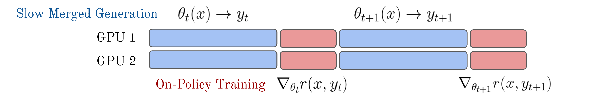

---

## Intermediate step: Separate GPUs, still on-policy

<!-- cite-right: noukhovitch2024asynchronous -->

Moving generation to an inference engine on its own GPUs makes it fast. To stay on-policy, each side waits for the other.

<!-- img-align: center -->

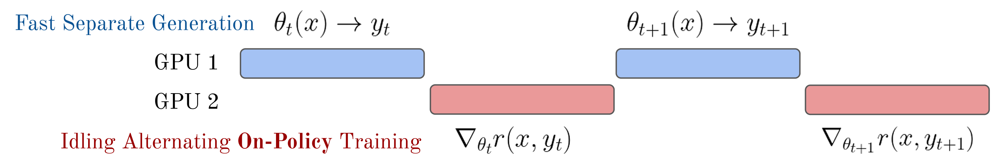

---

## Asynchronous: Off-policy training

<!-- cite-right: noukhovitch2024asynchronous -->

The common solution is to constantly run inference and training on separate GPU nodes. The model used for generation may be 1–N steps behind the training model.

<!-- img-align: center -->


This turns out to be mostly "fine" -- but it can be taken too far.

---

<!-- columns: 42/58 -->
## Synchronous vs. asynchronous training

<!-- cite-right: noukhovitch2024asynchronous -->

<div class="col-text-sm">

**Ideal / Theory (on-policy)**: generate → update → generate → update

Each batch of completions is scored and used for a short update window (one or a few epochs), then discarded.

**Reality (async)**: generation and training overlap on different GPU groups for better throughput. The model used for generation may be 1–N steps behind the training model.

**Tradeoff**: perfect on-policy is slow (GPUs idle during generation or training). Slight staleness (how off-policy the data is) is usually fine.

</div>

|||

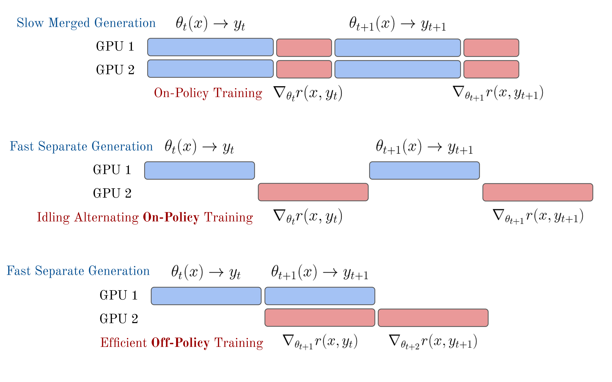

---

## Asynchronous RL training

<!-- columns: 50/50 -->

Modern RL for LLMs splits compute into two groups:

- **Actors** (inference GPUs): generate completions using vLLM or similar
- **Learners** (training GPUs): compute policy gradient updates

A process management library (e.g., Ray) coordinates data flow between them. Model weights are synced periodically from learner → actor.

|||

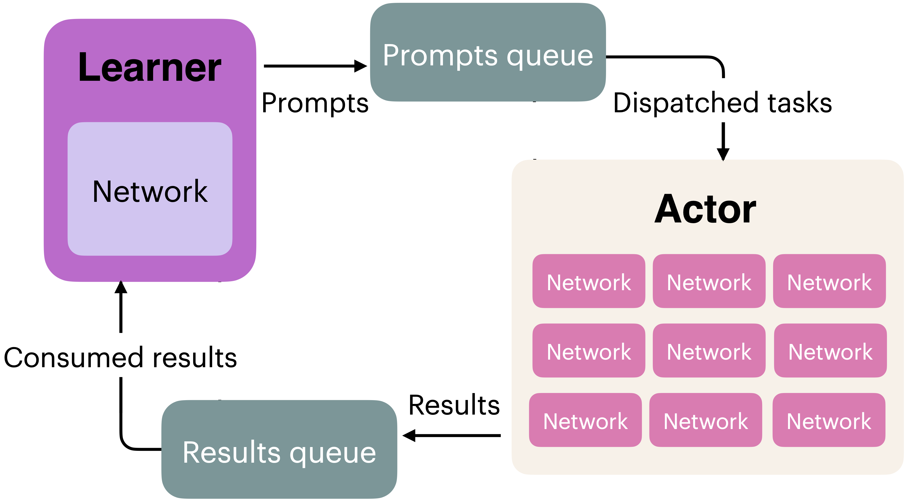

---


<!-- columns: 45/55 -->
<!-- valign: center -->
## The long-tail generations cause idle GPUs

<!-- cite-right: teamolmo2025olmo3 -->

With **static batching**, each actor generates a whole batch and returns it only when the longest sequence finishes.

- Wasted compute is (max length − mean length) / max length.
- Olmo 3 at a 32K limit: mean generation length 14,628, so up to **54%** of compute would be wasted.
- Agentic RL is worse: one trajectory makes 2 tool calls, another makes 200. Tool calls add additional lag and complexity.

|||

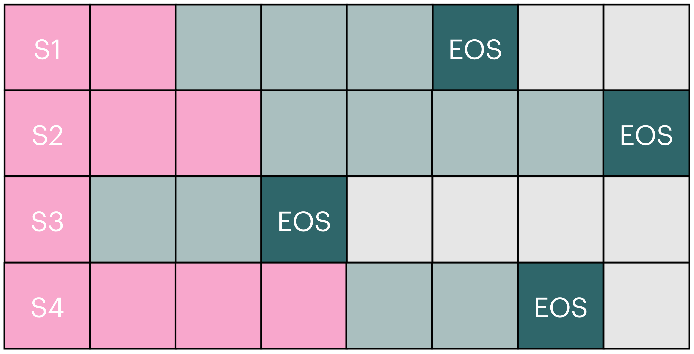

---


<!-- columns: 45/55 -->
<!-- valign: center -->
## Solution: Update inference model weights on the fly

<!-- cite-right: teamolmo2025olmo3 -->

<div class="col-text-sm">

| Olmo 3 RL infrastructure | Tokens/s |
|---|---:|
| Olmo 2 baseline | 881 |
| + continuous batching | 975 |
| + better threading | 1,358 |
| + inflight updates | **2,949** |

**Continuous batching:** start a new prompt as soon as a sequence finishes.

**Inflight updates:** load new weights without pausing generation or dropping the KV cache. The biggest speedup, but tokens in one completion now come from different weights.

</div>

|||

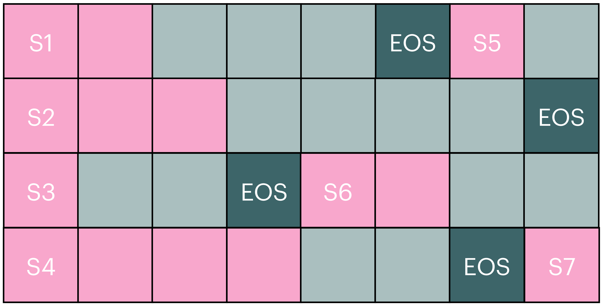

---


<!-- columns: 62/38 -->
<!-- valign: center -->
## Inflight updates: PipelineRL

The canonical reference for inflight weight updates is **PipelineRL** [@piche2025pipelinerl].

[arxiv.org/abs/2509.19128](https://arxiv.org/abs/2509.19128)

|||

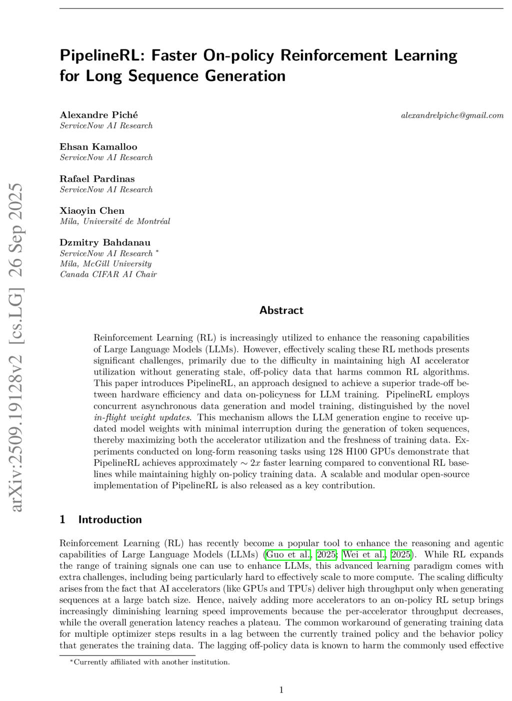

---

## One training step, end to end

```python
# 1. Sample completions on the inference engine (pseudocode)
input_ids, completion_mask = sampler.generate(prompts, n=G)

# 2. Score them, then center within each group
rewards = verifier(prompts, input_ids)                  # (B*G,)
advantages = group_center(rewards, G)                   # (B*G,)

# 3. Recompute log-probs on the trainer, this time with gradients
logits = model(input_ids).logits[:, :-1, :]
token_logprobs = logits.log_softmax(-1).gather(
    -1, input_ids[:, 1:].unsqueeze(-1)).squeeze(-1)
seq_logprobs = (token_logprobs * completion_mask[:, 1:]).sum(-1)

# 4. Update, then sync the new weights back to the sampler
(-(advantages * seq_logprobs).mean()).backward()
optimizer.step()
sampler.load_weights(model)
```

Steps 1 and 3 ask two different systems about the same tokens. Do they agree?

---

## Defining the mismatch

At one position, with prompt $x$ and prefix $a_{<t}$, each system defines a next-token distribution:

$$
\begin{aligned}
p_v &= \text{softmax}\big( f_\theta(x, a_{<t}) \big)_v && \text{learner: current weights, training numerics} \\
q_v &= \text{softmax}\big( \tilde{f}_{\tilde{\theta}}(x, a_{<t}) \big)_v && \text{sampler: synced weights, inference numerics}
\end{aligned}
$$

<!-- step -->

**Training-inference mismatch** (TIM) is when $q \neq p$. There are two independent sources:

- **Staleness:** $\tilde{\theta} \neq \theta$, because the weights have moved since the last syn (on the trainer side).
- **Numerics:** $\tilde{f} \neq f$, because of different kernels, precision, parallelism, or a quantized KV cache (the cached attention keys and values for the prefix, stored in fewer bits). See [Yao et al.](https://fengyao.notion.site/off-policy-rl) and [@marek2026score].


---

## Same tokens, different probabilities

<!-- cite-right: minimax2025minimax_m1 -->

<!-- img-align: center -->

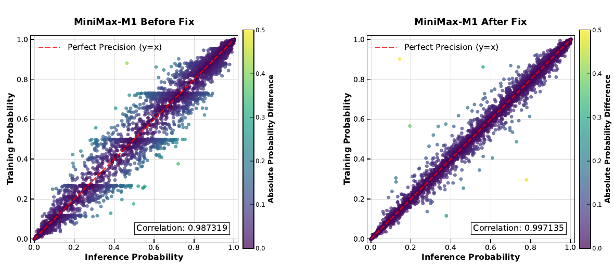

---

## What training actually estimates

The gradient we want samples from the learner:

$$\nabla_\theta J(\theta) = \mathbb{E}_{a \sim p_\theta}\left[ A \sum_{t=1}^{T} \nabla_\theta \log p_\theta(a_t \mid x, a_{<t}) \right]$$

<!-- step -->

The gradient we compute samples from the sampler, but differentiates through the learner:

$$\hat{g} = \mathbb{E}_{a \sim q}\left[ A \sum_{t=1}^{T} \nabla_\theta \log p_\theta(a_t \mid x, a_{<t}) \right]$$

<!-- step -->

These differ whenever $q \neq p$, and the gap has two parts: the tokens are drawn from the wrong distribution, and so are the prefixes they follow.

---

## The classical fix: Importance sampling

Reweighting by the sequence ratio recovers the gradient exactly [@marek2026score]:

$$\nabla_\theta J(\theta) = \mathbb{E}_{a \sim q}\left[ w(a) \, A \sum_{t=1}^{T} \boldsymbol{\xi}_{a_t} \right], \qquad w(a) = \frac{p_\theta(a \mid x)}{q(a \mid x)}$$

<!-- step -->

But $w$ can take very large values on rare tokens, which inflates the variance of the gradient.

Truncated importance sampling [@ionides2008truncated] caps the per-token ratio at a constant $C$, trading a small bias for bounded variance in the policy gradient:

$$w_t = \frac{p(a_t \mid x, a_{<t})}{q(a_t \mid x, a_{<t})}, \qquad \tilde{w}_t = \min(w_t, C)$$

---

## Truncated importance sampling in code

In practice, LLM RL systems apply TIS as a per-token correction weight on the policy-gradient loss:

```python
# Shape: (B*G, L)
C = 2.0  # TIS cap

logratio = learner_logprobs - sampler_logprobs
logratio = logratio.clamp(-10.0, 10.0)              # numerical safety
tis_weight = torch.exp(logratio).clamp(max=C)        # one-sided truncation

# Use as a fixed correction weight on the per-token PG loss
per_token_pg_loss = per_token_pg_loss * tis_weight.detach()
```

TIS for the learner–sampler ratio has been adopted across major open-source RL frameworks (VeRL, TRL, OpenRLHF, SkyRL, OAT, and Open Instruct, which uses $C = 2$).

---

<!-- class: diagram-sm -->
## Removing a source of mismatch: Routing replay

<!-- cite-right: ma2025r3 -->

In mixture-of-experts (MoE) models, the trainer's router can pick different experts than the sampler's for the same token. Rollout Routing Replay (R3) records the experts chosen at inference and reuses them in the training forward passes.

<!-- img-align: center -->

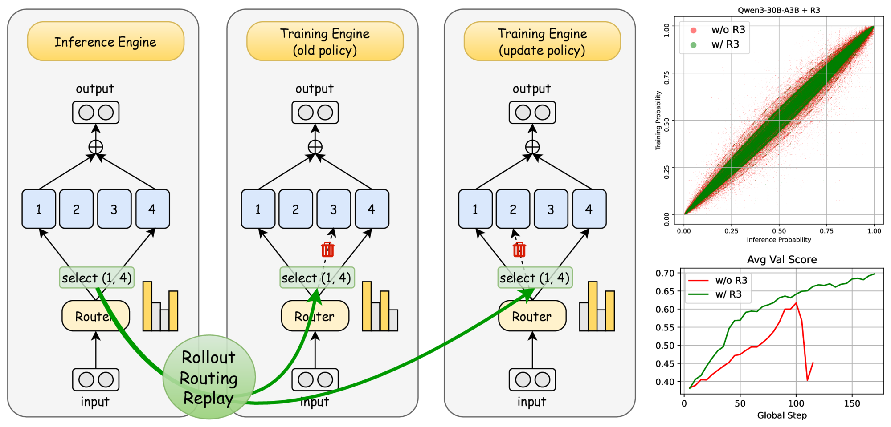

---

<!-- layout: section-break -->

## Score centering: managing train-inference mismatch

---

## Train-Inference-Mismatch (TIM) can collapse training

<!-- cite-right: marek2026score -->

<!-- img-align: center -->


---


## Recall: The policy gradient is a sum of scores

The policy gradient for one completion:

$$\nabla_\theta J(\theta) = \mathbb{E}_{a \sim p_\theta}\left[ A \sum_{t=1}^{T} \nabla_\theta \log p_\theta(a_t \mid x, a_{<t}) \right]$$

<!-- step -->

Call each term the [**score**](https://en.wikipedia.org/wiki/Informant_function) of the token, $\boldsymbol{\xi}_v = \nabla_\theta \log p_\theta(v \mid x, a_{<t})$:

$$\nabla_\theta J(\theta) = \mathbb{E}_{a \sim p_\theta}\left[ A \sum_{t=1}^{T} \boldsymbol{\xi}_{a_t} \right]$$

---

## The score has zero mean on-policy

<!-- cite-right: williams1992simple -->

At one position, the expected score under the learner, written as a sum:

$$\mathbb{E}_{v \sim p}[\boldsymbol{\xi}_v] = \sum_{v \in \mathcal{V}} p_v \, \nabla_\theta \log p_v$$

<div class="shorthand-note">

Shorthand: $p_v = p_\theta(v \mid x, a_{\lt t})$, the learner's probability of token $v$ at this position ($\theta$ dropped for brevity); $\mathcal{V}$ is the vocabulary.

</div>

<!-- step -->

Apply the log-derivative identity, $p_v \nabla_\theta \log p_v = \nabla_\theta p_v$:

$$= \sum_{v \in \mathcal{V}} \nabla_\theta p_v$$

<!-- step -->

Pull the gradient out of the sum. Probabilities sum to one:

$$= \nabla_\theta \sum_{v \in \mathcal{V}} p_v = \nabla_\theta 1 = \mathbf{0}$$

<!-- step -->

This is why baselines are free: $\mathbb{E}[b(x) \, \boldsymbol{\xi}_{a_t}] = b(x) \cdot \mathbf{0}$. It relies on the expectation and the score using **the same distribution**.

---

## Off-policy, the gradient scores are not zero mean

Tokens now come from $q$, but the score is still computed through $p$. Define the expected score under the sampler:

$$\bar{\boldsymbol{\xi}} = \mathbb{E}_{v \sim q}[\boldsymbol{\xi}_v] = \sum_{v \in \mathcal{V}} q_v \, \boldsymbol{\xi}_v$$

<div class="shorthand-note">

Shorthand: $q_v = q(v \mid x, a_{\lt t})$ for the sampler and $p_v = p_\theta(v \mid x, a_{\lt t})$ for the learner ($\theta$ dropped for brevity).

</div>

<!-- step -->

Apply the same log-derivative identity as before:

$$\bar{\boldsymbol{\xi}} = \sum_{v \in \mathcal{V}} \frac{q_v}{p_v} \, \nabla_\theta p_v$$

<!-- step -->

The weights are now $q_v / p_v$ instead of $1$, so the sum no longer collapses to $\nabla_\theta 1 = \mathbf{0}$. The expected score is zero when $q = p$, but not in general.

---

## Computing the gradient of one token

Start from the estimated gradient, and move the sum outside the expectation:

$$\hat{g} = \mathbb{E}_{a \sim q}\left[ \sum_{t} A \, \boldsymbol{\xi}_{a_t} \right] = \sum_{t} \mathbb{E}_{a \sim q}\left[ A \, \boldsymbol{\xi}_{a_t} \right]$$

<!-- step -->

Sequences are sampled one token at a time, so split each term into the prefix, then the token and everything after it:

$$\hat{g} = \sum_{t} \mathbb{E}_{a_{<t} \sim q}\Big[ \mathbb{E}_{a_{\geq t} \sim q}\big[ A \, \boldsymbol{\xi}_{a_t} \big] \Big]$$

<!-- step -->

From here on, fix the prefix (context) and study the inner term. 
We write it as $\mathbb{E}_q[A \, \boldsymbol{\xi}_{a_t}]$. 
With the prefix fixed, the token $a_t$ and the advantage $A$ are both still random variables.

---

## Which pieces of the gradient contribute to learning

Use the covariance identity, $\mathbb{E}[XY] = \mathbb{E}[X] \, \mathbb{E}[Y] + \text{Cov}(X, Y)$, starting on-policy, the expectation of the gradient:

$$
\begin{aligned}
\mathbb{E}_p[A \, \boldsymbol{\xi}_{a_t}] &= \mathbb{E}_p[A] \, \mathbb{E}_p[\boldsymbol{\xi}_{a_t}] + \text{Cov}_p(A, \boldsymbol{\xi}_{a_t}) \\
&= \mathbb{E}_p[A] \cdot \mathbf{0} + \text{Cov}_p(A, \boldsymbol{\xi}_{a_t}) \\
&= \text{Cov}_p(A, \boldsymbol{\xi}_{a_t})
\end{aligned}
$$

<!-- step -->

Now the same identity under the sampler, where $\mathbb{E}_q[\boldsymbol{\xi}_{a_t}] = \bar{\boldsymbol{\xi}}$:

$$
\mathbb{E}_q[A \, \boldsymbol{\xi}_{a_t}] = \mathbb{E}_q[A] \, \mathbb{E}_q[\boldsymbol{\xi}_{a_t}] + \text{Cov}_q(A, \boldsymbol{\xi}_{a_t}) = \underbrace{\mathbb{E}_q[A] \, \bar{\boldsymbol{\xi}}}_{\text{drift}} + \underbrace{\text{Cov}_q(A, \boldsymbol{\xi}_{a_t})}_{\text{signal}}
$$

<!-- step -->

Only the covariance sees which tokens led to which outcomes. The drift depends on the advantages only through their mean -- not per-token attribution.

---

## What the drift does

<!-- cite-right: marek2026score -->

The drift, $\mathbb{E}_q[A] \, \bar{\boldsymbol{\xi}}$, depends on the advantages only through their mean, so it moves the weights the same way regardless of which token was sampled.

We don't want that: in practice, it can pull the learner's weights toward a stale and/or quantized sampler, causing potentially compounding instabilities.

---

## Score centering: A baseline for the score

Baselines center the reward. Score centering centers the per-token log-prob gradients (called "score" in statistics), subtracting its expected value under the sampler:

$$\tilde{\boldsymbol{\xi}}_{a_t} = \boldsymbol{\xi}_{a_t} - \bar{\boldsymbol{\xi}}$$

<div class="shorthand-note">

Recall: the score of token $v$ is $\boldsymbol{\xi}_v = \nabla_\theta \log p_\theta(v \mid x, a_{\lt t})$, the gradient of its log-probability under the learner.

</div>

<!-- step -->

$\bar{\boldsymbol{\xi}}$ is a sum over the whole vocabulary at a fixed prefix, so it is a constant with respect to the sampled token:

$$\mathbb{E}_q[\tilde{\boldsymbol{\xi}}_{a_t}] = \mathbb{E}_q[\boldsymbol{\xi}_{a_t} - \bar{\boldsymbol{\xi}}] = \mathbb{E}_q[\boldsymbol{\xi}_{a_t}] - \bar{\boldsymbol{\xi}} = \bar{\boldsymbol{\xi}} - \bar{\boldsymbol{\xi}} = \mathbf{0}$$

<!-- step -->

The centered score has zero mean under the sampler! which restores the property that made on-policy learning attractive. When $q = p$ (on-policy), $\bar{\boldsymbol{\xi}} = \mathbf{0}$ and the correction does nothing.

---

## The corrected, per-token gradient

With the centered score, the policy-gradient estimate becomes:

$$\hat{g}_{\text{centered}} = \mathbb{E}_{a \sim q}\left[ A \sum_{t=1}^{T} \tilde{\boldsymbol{\xi}}_{a_t} \right] = \sum_{t} \mathbb{E}_{a_{<t} \sim q}\Big[ \mathbb{E}_q[A \, \tilde{\boldsymbol{\xi}}_{a_t}] \Big]$$

Apply the covariance identity to the inner, per-token term:

$$
\begin{aligned}
\mathbb{E}_q[A \, \tilde{\boldsymbol{\xi}}_{a_t}] &= \mathbb{E}_q[A] \, \mathbb{E}_q[\tilde{\boldsymbol{\xi}}_{a_t}] + \text{Cov}_q(A, \tilde{\boldsymbol{\xi}}_{a_t}) \\
&= \mathbb{E}_q[A] \, \mathbb{E}_q[\boldsymbol{\xi}_{a_t} - \bar{\boldsymbol{\xi}}] + \text{Cov}_q(A, \boldsymbol{\xi}_{a_t} - \bar{\boldsymbol{\xi}}) \\
&= \mathbb{E}_q[A] \left( \mathbb{E}_q[\boldsymbol{\xi}_{a_t}] - \bar{\boldsymbol{\xi}} \right) + \text{Cov}_q(A, \boldsymbol{\xi}_{a_t} - \bar{\boldsymbol{\xi}}) \\
&= \mathbb{E}_q[A] \left( \bar{\boldsymbol{\xi}} - \bar{\boldsymbol{\xi}} \right) + \text{Cov}_q(A, \boldsymbol{\xi}_{a_t} - \bar{\boldsymbol{\xi}}) \\
&= \text{Cov}_q(A, \boldsymbol{\xi}_{a_t})
\end{aligned}
$$

<!-- step -->

The last step uses that a constant does not change a covariance: $\text{Cov}(X, Y - c) = \text{Cov}(X, Y)$.

---

## Score centering complements other interventions like importance sampling

<!-- cite-right: marek2026score -->

- **Score centering** removes the drift, the pull toward the sampler that carries no learning signal.
- It does not make training on-policy: the signal is still $\text{Cov}_q(A, \boldsymbol{\xi}_{a_t})$, measured under the sampler, not the learner.
- **Importance sampling** (e.g., TIS) reweights samples toward the learner, but clipping the ratios lets some drift back in.
- They fix different problems and are composable. The score-centering paper recommends using both!

---

<!-- class: diagram-xs -->
## Quantization vs. staleness

<!-- cite-right: marek2026score -->

- **Quantization:** The sampler has the learner's weights, just lower precision. Score centering alone is enough.
- **Staleness:** The learner moves away from the sampler, so score centering needs importance sampling too. Taking several gradient steps per batch causes the same kind of staleness.

<!-- img-align: center -->

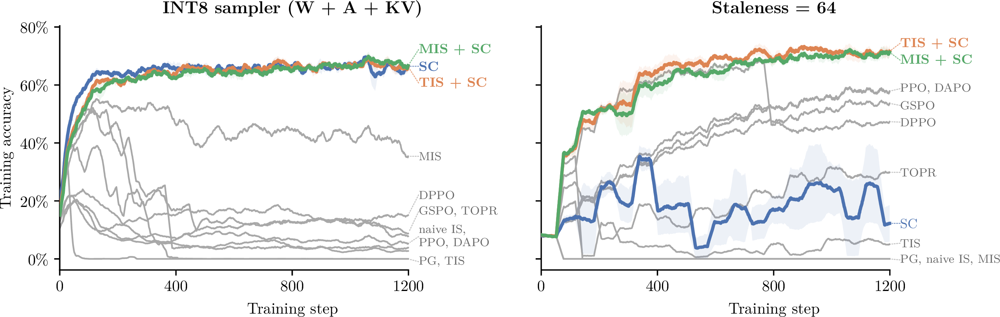

---


## Recent algorithms differ mostly in how they clip the log-ratio

<!-- cite-right: marek2026score -->

<!-- img-align: center -->

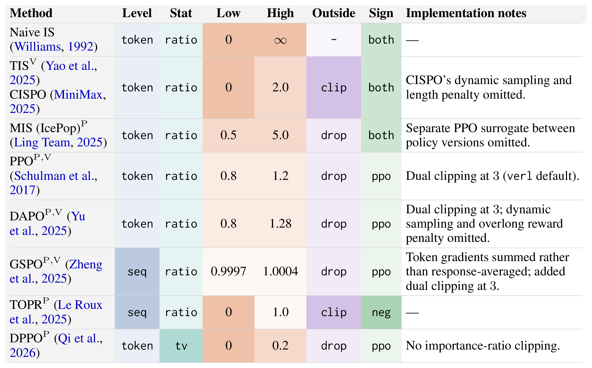

---

<!-- layout: section-break -->

## Score-centering in the wild (aka industry)

---

## StableReinforce and GRPO

(Supposedly) Many labs are supposedly using [**StableReinforce**](https://tinker-docs.thinkingmachines.ai/tinker/losses/stable-reinforce/), the loss Tinker added, rather than GRPO. This is unconfirmed, but the two are related.

The group advantages are nearly the same. GRPO normalizes each reward by the group mean and standard deviation:

$$A_i^{\text{GRPO}} = \frac{r_i - \text{mean}(r_1, \dots, r_G)}{\text{std}(r_1, \dots, r_G)}$$

<!-- step -->

REINFORCE with a group baseline is usually RLOO, which leaves each sample out of its own baseline:

$$A_i^{\text{RLOO}} = r_i - \frac{1}{G-1} \sum_{j \neq i} r_j = \frac{G}{G-1} \big( r_i - \text{mean}(r_1, \dots, r_G) \big)$$

<!-- step -->

Without the std, the two differ only by a constant scale. The bigger difference is the loss: GRPO usually wraps the advantage in PPO's clipped ratio, while REINFORCE uses the plain log-prob loss.

---

## Is StableReinforce score centering?

<!-- footnote-right: [Tinker docs](https://tinker-docs.thinkingmachines.ai/tinker/losses/stable-reinforce/) -->

Tinker's docs describe the behavior, but not the main loss:

> "In our internal post-training, this loss function has led to extremely stable training, even under highly off-policy async RL and low precision numerics."

<!-- step -->

They do reveal a clue: sampling must record extra information, through `record_stability_info=True`.

<!-- step -->

Frontier losses are rarely published, so public ideas are rarely confirmed. Here, Martin Marek, the score centering paper's first author, tried to recover the loss from its gradients alone.

---

## Reverse-engineering a loss from its gradients

<!-- footnote-right: [Marek's thread](https://x.com/mrtnm/status/2114145574987702525) -->

<!-- columns: 55/45 -->

Tinker does not expose the loss or the "stability info," but it does let you take a step and download the weights.

**Step 1: Recover the raw gradient.** Tinker has no SGD, so use Adam with $\epsilon = 10{,}000$. This dominates Adam's second moment:

$$\Delta w \approx -\frac{\text{lr} \cdot g}{\epsilon}$$

<!-- step -->

**Step 2: Read it in logit space.** Train a rank-1 LoRA adapter on the unembedding of Qwen3.5-4B. The gradient with respect to $B$ equals the gradient with respect to the logits, up to scale.

|||

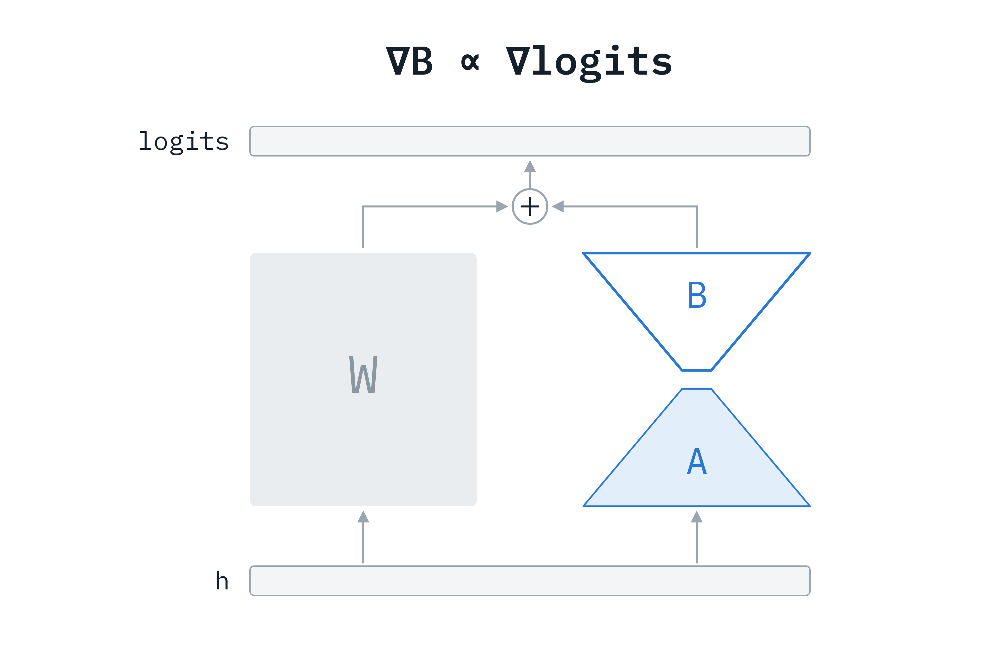

---

## Only 8 logits move

<!-- footnote-right: [Marek's thread](https://x.com/mrtnm/status/2114145574987702525) -->

<!-- columns: 32/68 -->

For a single-token update:

- **Reinforce** puts a nonzero gradient on all logits: 248,077 of them move.
- **StableReinforce** moves only 8.

<!-- step -->

The bars come in multiples of $1/8$, and the third row, Reinforce with score centering, is identical.

|||

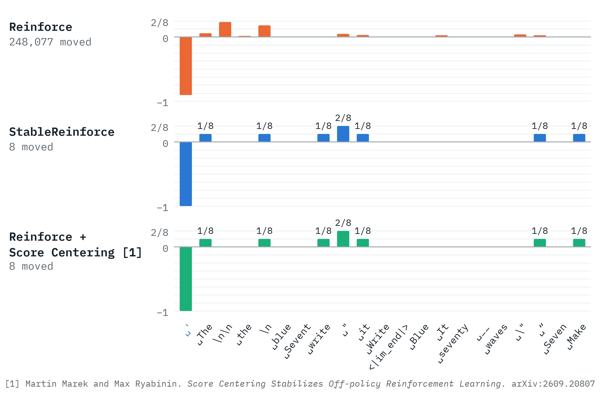

---

## Why a sparse gradient is the clue

<!-- footnote-right: [Marek's thread](https://x.com/mrtnm/status/2114145574987702525) -->

The plot shows gradients with respect to the logits $z$. For a softmax, the gradient of $\log p_v$ is the one-hot vector $e_v$ minus the probabilities:

$$\boldsymbol{\xi}_v = \nabla_z \log p_v = e_v - p$$

<!-- step -->

Estimate $\bar{\boldsymbol{\xi}}$ by drawing 8 tokens from the sampler, $v_1, \dots, v_8 \sim q$:

$$\bar{\boldsymbol{\xi}} \approx \frac{1}{8} \sum_{i=1}^{8} \boldsymbol{\xi}_{v_i} = \frac{1}{8} \sum_{i=1}^{8} (e_{v_i} - p) = \frac{1}{8} \sum_{i=1}^{8} e_{v_i} - p$$

<!-- step -->

Subtract it from the score of the sampled token. The dense $-p$ cancels exactly:

$$\boldsymbol{\xi}_{a_t} - \bar{\boldsymbol{\xi}} \approx (e_{a_t} - p) - \left( \frac{1}{8} \sum_{i=1}^{8} e_{v_i} - p \right) = e_{a_t} - \frac{1}{8} \sum_{i=1}^{8} e_{v_i}$$

<!-- step -->

Flip the signs for a loss and this is the figure: $-1$ on the sampled token, $+1/8$ per draw.

---

## The match

<!-- footnote-right: [Marek's thread](https://x.com/mrtnm/status/2114145574987702525) -->

**Hypothesis:** StableReinforce is REINFORCE plus score centering, with the expected score computed over 8 randomly sampled tokens.

<!-- step -->

**Test:** Implement that as a custom Tinker loss, take an optimizer step, and compare. The gradients are within numeric precision across all layers.

<!-- img-align: center -->

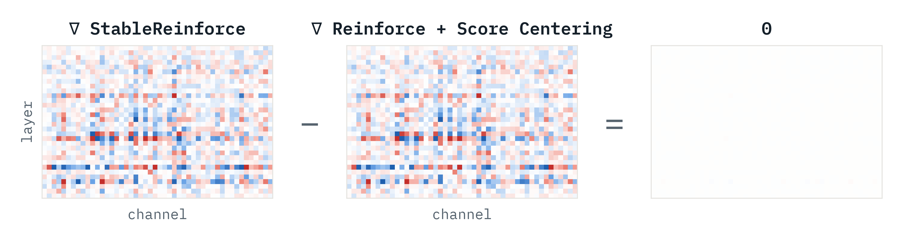

---

## Score centering in a recent model

<!-- footnote-right: [Ricursive Intelligence](https://www.ricursive.com/ripple) -->

Ripple-65B Preview, a 65B open-weight model from Ricursive (built on a lot of Olmo 3 infra!), names score centering in its post-training:

> "Our mixed RL recipe uses truncated importance sampling, score centering, and linear length penalty with high-quality long-horizon synthetic environments."

---

<!-- layout: section-break -->
## Wrapping up

---

## Takeaways


---

<!-- columns: 38/62 -->
<!-- valign: center -->
## Thank you

I have a lot of content expanding on this stuff!

- **Course:** 14 lectures, Q&As, and guest episodes at [rlhfbook.com/course](https://rlhfbook.com/course)
- **Book:** [rlhfbook.com](https://rlhfbook.com), also in print from [Manning](https://www.manning.com/books/reinforcement-learning-from-human-feedback)
- **Newsletter:** [interconnects.ai](https://www.interconnects.ai/)

nathan@natolambert.com

|||

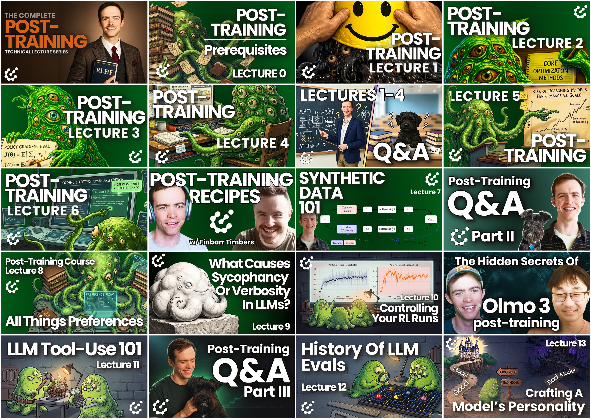

---


<!-- after: references -->
<!-- layout: section-break -->

## Extra slides

---


<!-- after: references -->
## Measuring the mismatch at one token

The ratio between the two systems for a sampled token, and its log:

$$w_t = \frac{p(a_t \mid x, a_{<t})}{q(a_t \mid x, a_{<t})}, \qquad \delta_t = \log w_t = \log p(a_t \mid x, a_{<t}) - \log q(a_t \mid x, a_{<t})$$

Tokens are sampled from $q$, so take the expectation under $q$:

$$\mathbb{E}_{a_t \sim q}[\delta_t] = \sum_{v \in \mathcal{V}} q_v \left( \log p_v - \log q_v \right)$$

Flip the sign to recognize the KL divergence:

$$\mathbb{E}_{a_t \sim q}[\delta_t] = -\sum_{v \in \mathcal{V}} q_v \log \frac{q_v}{p_v} = -\text{KL}(q_t \,\Vert\, p_t)$$

If the systems agree, every $\delta_t$ is zero. Otherwise, log-ratios are negative on average.

---


<!-- after: references -->
## Mismatch adds up over a completion

The ratio for a whole completion is the product of the token ratios:

$$w(a) = \frac{p_\theta(a \mid x)}{q(a \mid x)} = \prod_{t=1}^{T} w_t, \qquad \log w(a) = \sum_{t=1}^{T} \delta_t$$

Take the expectation under $q$, and apply the previous slide at each position:

$$\mathbb{E}_{a \sim q}[\log w(a)] = \sum_{t=1}^{T} \mathbb{E}_{a_{<t} \sim q}\big[ \mathbb{E}_{a_t \sim q}[\delta_t] \big] = -\sum_{t=1}^{T} \mathbb{E}_{a_{<t} \sim q}\big[ \text{KL}(q_t \,\Vert\, p_t) \big]$$

This sum is the KL between the two sequence distributions, $\text{KL}\big(q(a \mid x) \,\Vert\, p_\theta(a \mid x)\big)$, so it grows with length.

For illustration, a small per-token KL of $0.001$ over $10{,}000$ tokens gives a sequence KL of $10$ nats. A typical weight is then near $e^{-10} \approx 5 \times 10^{-5}$.

---

<!-- after: references -->
## What is the score?

In statistics, the [**score**](https://en.wikipedia.org/wiki/Informant_function) is the gradient of the log-likelihood with respect to the parameters. For one token $v$ at one position:

$$\boldsymbol{\xi}_v = \nabla_\theta \log p_\theta(v \mid x, a_{<t})$$

- It is a vector the size of the parameters: the direction that makes token $v$ more likely.
- The policy gradient is an advantage-weighted sum of the scores of the sampled tokens:

$$\nabla_\theta J(\theta) = \mathbb{E}\left[ A \sum_{t=1}^{T} \boldsymbol{\xi}_{a_t} \right]$$

---


<!-- after: references -->
## Why the drift compounds

<!-- cite-right: marek2026score -->

Distilling toward a **fixed** teacher is harmless. It converges to the best fit of that teacher.

In online RL, the teacher moves with the student:

- The sampler is a biased copy of the learner, e.g., quantized or stale.
- Each step pulls the learner toward the sampler's errors.
- The new weights are synced back to the sampler, carrying those errors with them.
- The next sampler is biased again, so the error compounds instead of converging.
- The bias does not average out with more samples, since $\bar{\boldsymbol{\xi}}$ is fixed at each prefix. It needs a direct correction.

---


<!-- after: references -->
## Do group baselines already fix this?

<!-- cite-right: marek2026score -->

Not fully. Group centering makes advantages sum to zero **over the rollouts of a prompt**:

$$\frac{1}{G} \sum_{i=1}^{G} (r_i - \bar{r}) = 0$$

But drift arises **at each prefix**, and $\mathbb{E}_q[A \mid x, a_{<t}]$ is generally not zero there:

- A prefix likely to reach a correct answer has positive expected advantage.
- A prefix that already contains a mistake has negative expected advantage.

Group centering shrinks drift relative to all-positive rewards, and it was the most stable reward setting in the paper's online experiments. It does not eliminate drift.

---


<!-- after: references -->
## From the update to a loss

<!-- cite-right: marek2026score -->

We want a scalar whose gradient is $A \, (\boldsymbol{\xi}_{a_t} - \bar{\boldsymbol{\xi}})$.

The first piece is already a gradient, $\boldsymbol{\xi}_{a_t} = \nabla_\theta \log p_{a_t}$. For the second:

$$\bar{\boldsymbol{\xi}} = \sum_{v \in \mathcal{V}} q_v \, \nabla_\theta \log p_v$$

The sampler's probabilities are logged values, so we mark them as constants with a stop-gradient and pull the gradient out:

$$\bar{\boldsymbol{\xi}} = \nabla_\theta \sum_{v \in \mathcal{V}} \text{sg}[q_v] \log p_v$$

Combine the two pieces, and multiply by $-A$:

$$L = -A \left( \log p_{a_t} - \sum_{v \in \mathcal{V}} \text{sg}[q_v] \log p_v \right), \qquad -\nabla_\theta L = A \, (\boldsymbol{\xi}_{a_t} - \bar{\boldsymbol{\xi}}) = A \, \tilde{\boldsymbol{\xi}}_{a_t}$$

---


<!-- after: references -->
## Score centering in code

The correction is one extra term in the REINFORCE loss from earlier:

```python
# Learner: log-probs over the whole vocabulary, with gradients
learner_vocab_logprobs = logits.log_softmax(-1)              # (B*G, L, V)
learner_logprobs = learner_vocab_logprobs.gather(
    -1, tokens.unsqueeze(-1)).squeeze(-1)                    # (B*G, L)

# Sampler: logged at generation time, so it has no gradient path
sampler_probs = sampler_vocab_logprobs.exp()                 # (B*G, L, V)

# The gradient of `centering` is the expected score, s-bar
centering = (sampler_probs * learner_vocab_logprobs).sum(-1) # (B*G, L)

# advantages: (B*G, 1), broadcast to every token
per_token_loss = -advantages * (learner_logprobs - centering)
loss = ((per_token_loss * mask).sum(1) / mask.sum(1)).mean()
```

No ratios, no masks, and no clipping. On-policy, the gradient of `centering` is zero.

---


<!-- after: references -->
## The full distribution is too expensive

<!-- cite-right: marek2026score -->

Computing $\bar{\boldsymbol{\xi}}$ exactly needs the sampler's next-token distribution at every position:

- Qwen3's vocabulary has 152K tokens, so one position in fp32 takes about 608KB.
- A batch of 1024 rollouts with 32K tokens each would take about 20TB.

Instead, log only the sampler's **head** $H$, its $k$ most likely tokens at that position, with $k = 128$. Model the **tail** with the learner, rescaled to carry the sampler's missing mass:

$$
\hat{q}_v =
\begin{cases}
q_v & v \in H \\
\rho \, p_v & v \notin H
\end{cases}
\qquad
\rho = \frac{1 - \sum_{v \in H} q_v}{1 - \sum_{v \in H} p_v}
$$

---


<!-- after: references -->
## The tail cancels

<!-- cite-right: marek2026score -->

Substitute $\hat{q}$ into the expected score, and split the sum into head and tail:

$$\bar{\boldsymbol{\xi}} \approx \sum_{v} \hat{q}_v \, \boldsymbol{\xi}_v = \sum_{v \in H} q_v \, \boldsymbol{\xi}_v + \rho \sum_{v \notin H} p_v \, \boldsymbol{\xi}_v$$

The zero-mean identity splits the same way, which rewrites the tail in terms of the head:

$$\mathbf{0} = \sum_{v} p_v \, \boldsymbol{\xi}_v = \sum_{v \in H} p_v \, \boldsymbol{\xi}_v + \sum_{v \notin H} p_v \, \boldsymbol{\xi}_v \quad \Rightarrow \quad \sum_{v \notin H} p_v \, \boldsymbol{\xi}_v = -\sum_{v \in H} p_v \, \boldsymbol{\xi}_v$$

Substitute, and collect the terms. Only the $k$ head tokens remain:

$$\bar{\boldsymbol{\xi}} \approx \sum_{v \in H} q_v \, \boldsymbol{\xi}_v - \rho \sum_{v \in H} p_v \, \boldsymbol{\xi}_v = \sum_{v \in H} (q_v - \rho \, p_v) \, \boldsymbol{\xi}_v$$

The paper reports that $k = 128$ and $k = 32$ both perform on par with the full vocabulary, at under 1% wall-clock overhead for $k = 128$.

---


<!-- after: references -->
## Top-k score centering in code

<!-- cite-right: marek2026score -->

```python
# Logged during generation: sampler_topk_logprobs, sampler_topk_ids (B*G, L, k)
learner_logprobs = learner_vocab_logprobs.gather(-1, tokens[..., None])[..., 0]
head_logprobs = learner_vocab_logprobs.gather(-1, sampler_topk_ids)  # (B*G, L, k)
learner_head_probs = head_logprobs.exp()
sampler_head_probs = sampler_topk_logprobs.exp()

# rho: the ratio of the sampler's tail mass to the learner's tail mass
sampler_tail = (1 - sampler_head_probs.sum(-1)).clamp_min(1e-6)
learner_tail = (1 - learner_head_probs.sum(-1)).clamp_min(1e-6)
rho = sampler_tail / learner_tail                                    # (B*G, L)

# detach() is required: coef contains the learner's own probabilities
coef = (sampler_head_probs - rho[..., None] * learner_head_probs).detach()
centering = (coef * head_logprobs).sum(-1)                           # (B*G, L)

per_token_loss = -advantages * (learner_logprobs - centering)
```
